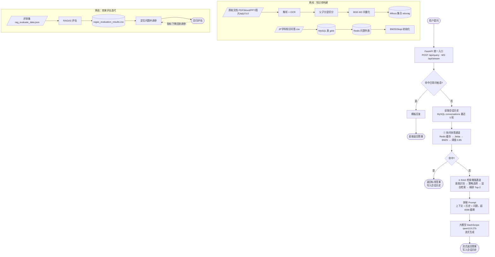
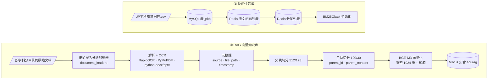
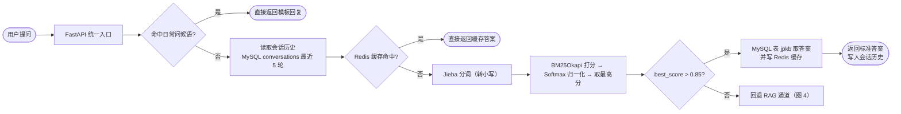
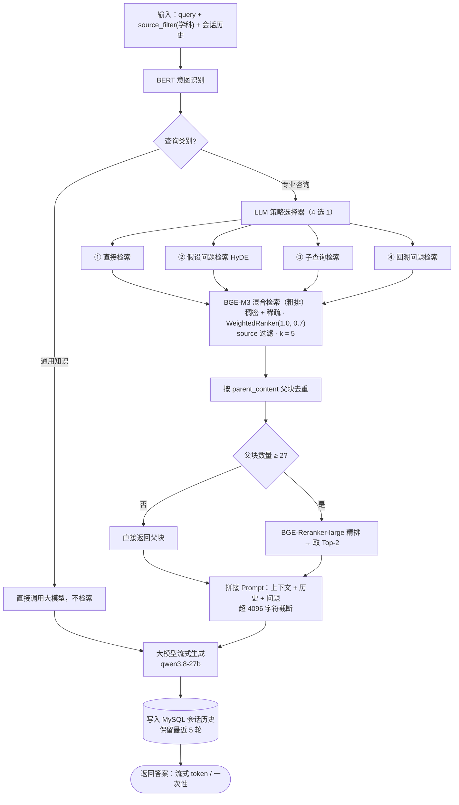

# edu_rag 智能问答项目 · 规范流程图

> 依据 `D:\Python-Project\edu_rag` 现有代码整理，画出的是**代码里真实执行的流程**，
> 不是理想化设计。图源文件在 `docs/figures/`，可重新生成：
> `D:\software\Anaconda\python.exe docs\make_flowchart.py`

---

## 一、制图规范（符号与颜色约定）

| 符号 | 形状 | 含义 | 本图中用于 |
| --- | --- | --- | --- |
| 起止 | 圆角矩形 / 椭圆 | 流程开始或结束 | 用户提问、返回答案 |
| 处理 | 矩形 | 执行动作 | 分词、向量化、检索、生成 |
| 判断 | 菱形 | 条件分支，必有“是/否”出口 | 意图识别、阈值判断、缓存命中 |
| 数据/存储 | 圆柱 | 数据读写 | MySQL、Redis、Milvus、CSV 报告 |
| 输入/输出 | 平行四边形 | 外部输入或产出物 | 原始文档、评测集、题库 CSV |
| 子流程 | 双竖线矩形 | 另有详细图 | 快问快答通道、RAG 通道 |
| 外部服务 | 浅青色矩形 | 项目外的服务 | 大模型 DashScope |
| 说明 | 虚线框 | 注释，不参与流程 | 参数、字段、注意事项 |

连线约定：实线为主流程；虚线为「跨图引用 / 说明 / 回环」；分支出口用绿色 **是**、红色 **否**。
颜色约定：绿色=起止，蓝色=处理，黄色=判断，紫色=数据，橙色=输入输出，青色=外部服务。

---

## 二、图 1 · 总体流程图

三个阶段：

- **A 离线准备**（`rag_qa` 建向量库 + `mysql_qa` 建题库，文档/题库变更时重跑）
- **B 在线问答**（一次请求：问候语拦截 → 读历史 → 快问快答通道 → 未命中则 RAG 通道 → 流式返回）
- **C 效果评估**（RAGAS 指标 → 调参 → 回归评估，参数写回 `config.ini` / `.env`）

---

## 三、图 2 · 离线知识库构建

两条并行链路：

1. **RAG 向量知识库**：文档 → 按扩展名分派加载器 → 解析/OCR → 元数据 → 父块切分 → 子块切分 → BGE-M3 向量化 → upsert 到 Milvus。
2. **快问快答库**：`JP学科知识问答.csv` → MySQL 表 `jpkb` → Redis 问题列表（原文 + 分词）→ BM25Okapi 初始化。

---

## 四、图 3 · 在线问答通道一：快问快答

关键点：命中即直接返回，代价极低；没命中才把控制权交给 RAG。

- 问候语用正则模板直接回，不触发任何检索；
- 答案缓存 key 是 `answer:{原始问题}`；
- 阈值判定用的是 **Softmax 归一化后的分数**（不是原始 BM25 分值），阈值默认 `0.85`；
- BM25 命中但 MySQL 取不到答案时，同样返回 `need_rag=True` 回退 RAG。

---

## 五、图 4 · 在线问答通道二：RAG 检索增强

关键点：

- 先用 BERT 分类器区分「通用知识 / 专业咨询」，通用知识不检索、直接问大模型；
- 专业咨询由 LLM 在 4 种策略里选 1 种：直接检索、HyDE、子查询检索、回溯问题检索；
- 检索是 BGE-M3 稠密 + 稀疏的混合检索（`WeightedRanker(1.0, 0.7)`），先按 `parent_content` 去重父块，再用 BGE-Reranker 精排，取 Top-2 拼上下文；
- 提示词 = 上下文 + 最近 5 轮历史 + 问题，超过 4096 字符截断；生成是流式 `yield token`。

---

## 六、Mermaid 源码（可复制到 mermaid.live / Typora / draw.io 重绘）

### 图 1 总体流程

### 图 2 离线知识库构建

### 图 3 快问快答通道

### 图 4 RAG 检索增强通道

---

## 七、流程步骤与代码文件对照

| 流程步骤 | 代码位置 |
| --- | --- |
| 接口入口、问候语拦截、流式 WebSocket | `app.py` |
| 总调度：先 MySQL 快问快答，未命中回退 RAG | `new_main.py`（`IntegratedQASystem.query`） |
| 会话历史读写（保留 5 轮） | `new_main.py`（`init_conversation_table` / `update_session_history`） |
| MySQL 连接与 `jpkb` 表 | `mysql_qa/db/mysql_client.py` |
| Redis 缓存（答案 / 问题列表） | `mysql_qa/cache/redis_client.py` |
| Jieba 分词预处理 | `mysql_qa/utils/preprocess.py` |
| BM25 打分、Softmax 归一化、阈值判定 | `mysql_qa/retrieval/bm25_search.py` |
| 知识库构建入口（文档 → Milvus） | `rag_qa/rag_main.py` |
| 文档加载与父子切分 | `rag_qa/core/document_processor.py` |
| OCR 与各格式加载器 | `rag_qa/edu_document_loaders/*.py` |
| 中文递归切分器 | `rag_qa/edu_text_spliter/edu_chinese_recursive_text_splitter.py` |
| BGE-M3 向量化、Milvus 建集合、混合检索 + 重排 | `rag_qa/core/vector_store.py` |
| BERT 意图识别（通用知识 / 专业咨询） | `rag_qa/core/query_classifier.py` |
| 四种检索策略的选择与实现 | `rag_qa/core/strategy_selector.py` + `rag_qa/core/new_rag_system.py` |
| 提示词模板（RAG / HyDE / 子查询 / 回溯） | `rag_qa/core/prompts.py` |
| RAGAS 效果评估 | `rag_qa/rag_assessment/ragas_evaluate.py`、`ollama_ragas.py` |
| 参数配置（切分、k、M、模型、连接） | `config.ini` + `base/config.py` |

---

## 八、与原始示意图的主要差异

| 原始示意图的问题 | 规范图的做法 |
| --- | --- |
| 线条交叉、右侧文字说明直接压在箭头上 | 统一左→右 / 上→下流向，说明文字独立成虚线框 |
| 判断节点没有明确的“是/否”出口 | 每个菱形都标明是/否分支与去向 |
| 存储（Redis / MySQL / Milvus）与处理步骤混用同一种方框 | 存储统一用圆柱，处理用矩形 |
| 一个图里挤了 30 多个节点，无法看清层级 | 拆成 1 张总览 + 3 张详细图，总览用子流程框引用 |
| 缺少起止节点和闭环（评估、调参） | 补起止节点，补 RAGAS 评估 → 调参 → 回归闭环 |
