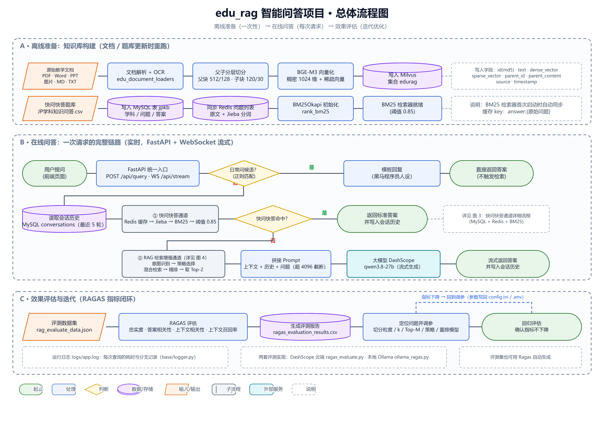
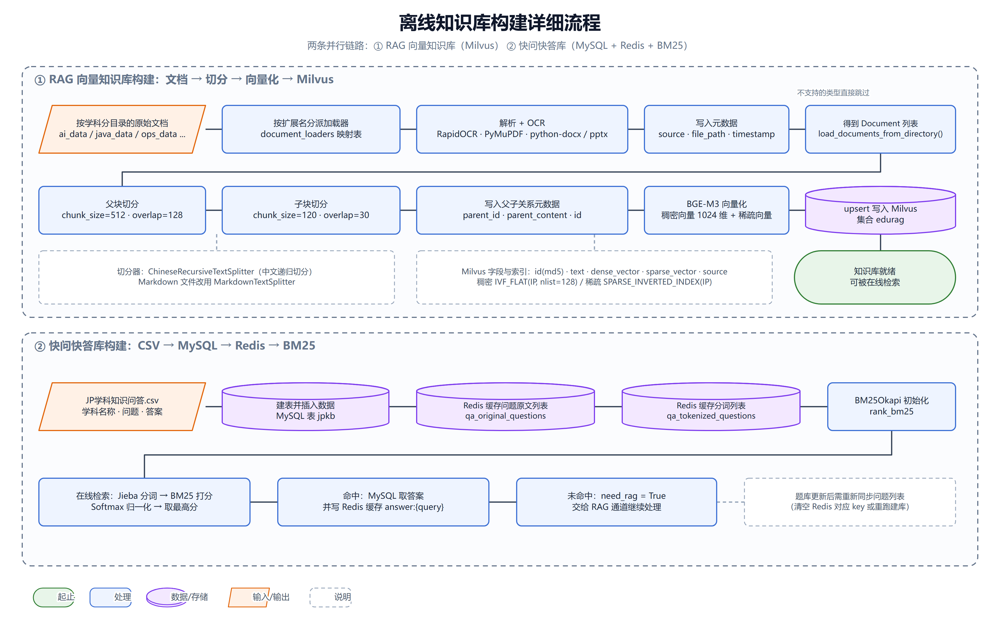
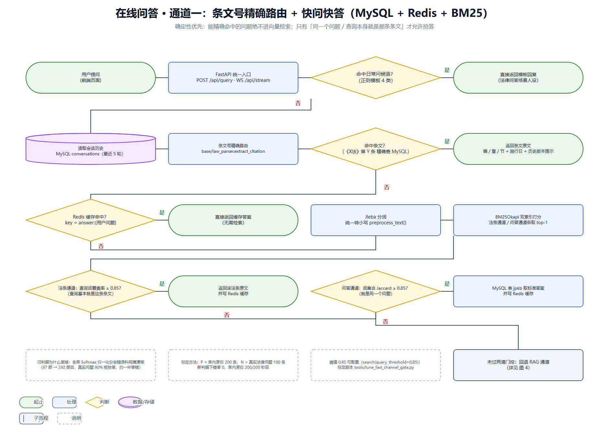
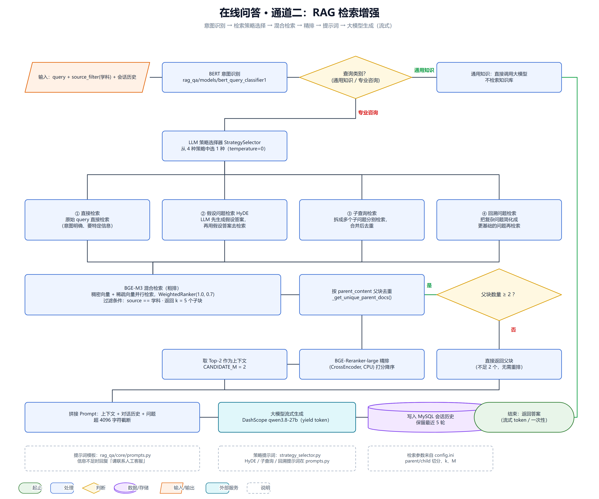
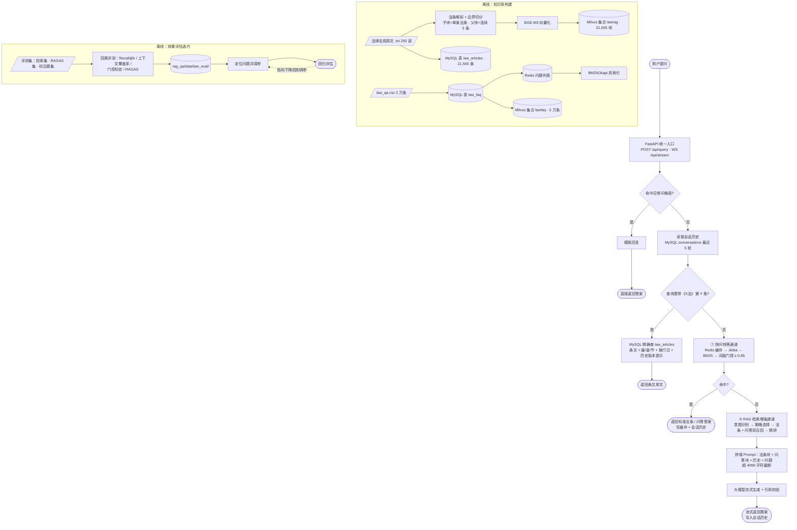
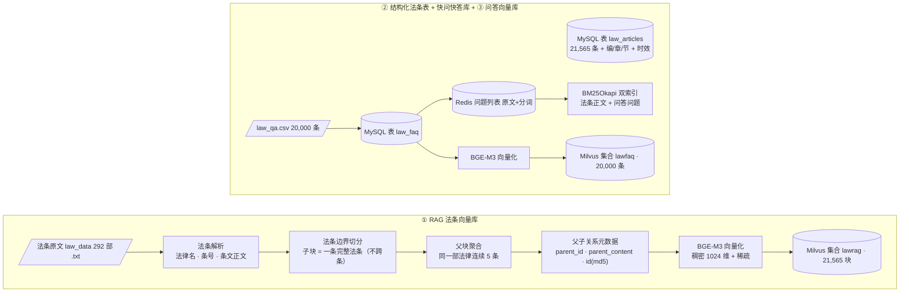
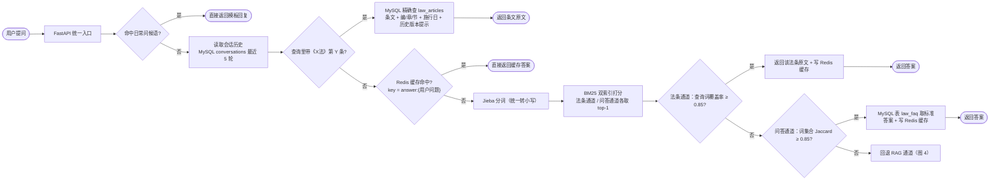
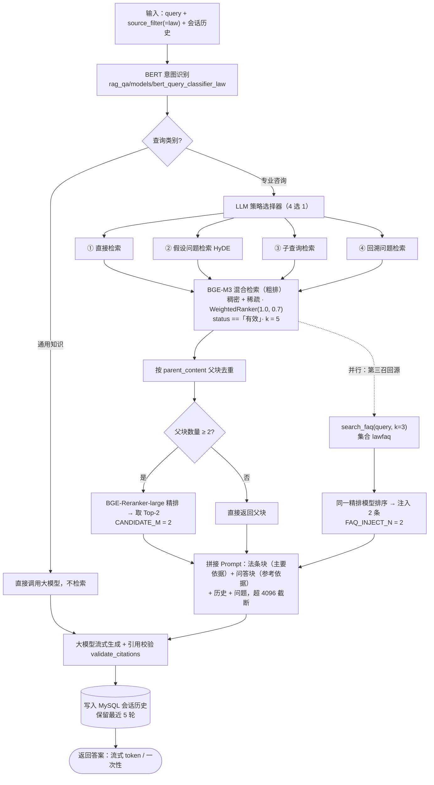

# lawrag 法律法规智能问答项目 · 规范流程图

> 依据 `D:\Python-Project\lawrag` 现有代码整理（法律方向改造后的版本），画出的是**代码里真实执行的流程**，
> 不是理想化设计。图源文件在 `docs/figures/`，重新生成：
>
> ```
> python docs\make_flowchart.py
> ```
>
> 脚本只用标准库，输出 `docs/figures/{overview,indexing,faq,rag}.svg`；
> 需要 PNG 时用无头浏览器把 SVG 截图即可（`docs/figures/` 里已附带 PNG）。

---

## 一、制图规范（符号与颜色约定）

| 符号 | 形状 | 含义 | 本图中用于 |
| --- | --- | --- | --- |
| 起止 | 圆角矩形 / 椭圆 | 流程开始或结束 | 用户提问、返回答案 |
| 处理 | 矩形 | 执行动作 | 解析、切分、向量化、检索、生成 |
| 判断 | 菱形 | 条件分支，必有「是/否」出口 | 问候语、条文号命中、门控阈值、父块数 |
| 数据/存储 | 圆柱 | 数据读写 | MySQL、Redis、Milvus、评测结果 |
| 输入/输出 | 平行四边形 | 外部输入或产出物 | 法条原文、问答 CSV、评测集 |
| 子流程 | 双竖线矩形 | 另有详细图 | 快问快答通道、RAG 通道 |
| 外部服务 | 浅青色矩形 | 项目外的服务 | 大模型 DashScope |
| 说明 | 虚线框 | 注释，不参与流程 | 字段、参数、注意事项 |

连线约定：实线为主流程；虚线为「跨图引用 / 说明 / 回环」；分支出口用绿色 **是**、红色 **否**。
颜色约定：绿色=起止，蓝色=处理，黄色=判断，紫色=数据，橙色=输入输出，青色=外部服务。

---

## 二、图 1 · 总体流程图



三个阶段：

- **A 离线准备**（法条向量库 + 结构化法条表 + 快问快答库 + 问答向量库，数据变更时重跑）
- **B 在线问答**（一次请求：问候语拦截 → 读历史 → 条文号精确路由 → 快问快答通道 → 未命中则 RAG 通道 → 流式返回）
- **C 效果评估**（四类评测 → 调参 → 回归，参数写回 `config.ini` / `.env`）

在线链路的三个关键判断点，也是这个项目最值得讲的三个设计：

1. **问候语**：正则模板直接回，不触发任何检索；
2. **条文号精确路由**：查询里出现《X法》第 Y 条时走 MySQL 精确查，**确定性检索优先于语义检索**；
3. **快通道门控**：只有「同一个问题 / 查询本身就是那条条文」才允许秒回，其余一律交给 RAG。

---

## 三、图 2 · 离线知识库构建



三条并行链路，共用同一份法条原文：

1. **RAG 法条向量库**：法条原文 → 法条解析（法律名 / 条号 / 正文）→ 法条边界切分（子块 = 一条完整法条，父块 = 同法连续 5 条）→ BGE-M3 向量化 → upsert 到 Milvus 集合 `lawrag`（21,565 块）。
2. **结构化法条表 + 快问快答库**：法条入库 MySQL `law_articles`（含编/章/节、公布日、施行日、时效状态）→ 供条文号精确路由与法条 BM25 使用；`law_qa.csv`（2 万条）→ MySQL 表 `law_faq` → Redis 问题列表 → BM25Okapi 双索引。
3. **问答向量库**：`law_faq` 的 2 万条问答 → BGE-M3 向量化 → Milvus 集合 `lawfaq`，作为 RAG 的**第三召回源**。

两个容易踩的坑（都在图里标了）：

- 法条集合的检索强制 `status ==「有效」`，问答条目没有这个字段，**混进同一个集合会被整条过滤掉**，所以问答单独建集合；
- 重建 `law_articles` 必须先 TRUNCATE 再写：旧语料与新语料条号会重号，`INSERT IGNORE` 会静默跳过，库里的条数就永远对不上。

---

## 四、图 3 · 在线问答通道一：条文号精确路由 + 快问快答



关键点：**能精确命中的问题绝不进向量检索**；命中即直接返回，代价极低。

- 问候语用正则模板直接回；
- 《X法》第 Y 条这类引用走 MySQL 精确查，返回时带上编/章/节、施行日期，若库里另存历史版本还会提示「引的是现行有效版本」；
- 答案缓存 key 是 `answer:{用户问题}`，TTL 7 天；
- 门控已从「全库 Softmax 归一化分 > 0.85」改成**词面判据**：
  - 法条通道看「查询词覆盖率 ≥ 0.85」（查询基本就是这条条文），
  - 问答通道看「词集合 Jaccard ≥ 0.85」（就是同一个问题）；
- 阈值由 `tools/tune_fast_channel_gate.py` 标定（P = 库内原句 200 条，N = 真实法律问题 100 条）：新判据下**错答 0、库内原句 200/200 仍秒回**。

---

## 五、图 4 · 在线问答通道二：RAG 检索增强



关键点：

- 先用 BERT 分类器区分「通用知识 / 专业咨询」，通用知识不检索、直接问大模型；
- 专业咨询由 LLM 在 4 种策略里选 1 种：直接检索、HyDE、子查询检索、回溯问题检索；
- 检索是 BGE-M3 稠密 + 稀疏的混合检索（`WeightedRanker(1.0, 0.7)`），过滤 `status ==「有效」`、返回 k = 5 个子块；先按 `parent_content` 去重父块，再用 BGE-Reranker 精排，取 Top-2 作为**法条块**；
- 与此同时问答走单独一路：`search_faq(query, k=3)` 从 `lawfaq` 召回，用**同一个精排模型**排序，注入 2 条作为**问答块**；
- 提示词 = 法条块（主要依据）+ 问答块（参考依据）+ 最近 5 轮历史 + 问题，超过 4096 字符截断；生成是流式 `yield token`，生成后再做引用校验。

> 只把第三召回源接进来、不改提示词，模型仍然会回「未找到直接依据」——提示词里必须明确两类上下文块的用法，
> 实测这一步让条文覆盖率从 65% 提到 75%（详见设计文档§18）。

---

## 六、Mermaid 源码（可复制到 mermaid.live / Typora / draw.io 重绘）

### 图 1 总体流程



### 图 2 离线知识库构建



### 图 3 在线问答通道一（条文号路由 + 快问快答）



### 图 4 在线问答通道二（RAG 检索增强）



---

## 七、流程步骤与代码文件对照

| 流程步骤 | 代码位置 |
| --- | --- |
| 接口入口、问候语拦截、流式 WebSocket | `app.py` |
| 总调度：条文号精确路由 → 快通道 → 回退 RAG | `new_main.py`（`IntegratedQASystem.query` / `_answer_by_citation`） |
| 会话历史读写（保留 5 轮） | `new_main.py`（`init_conversation_table` / `update_session_history`） |
| 条文引用抽取（《X法》第 Y 条）与法条解析 | `base/law_parser.py`（`extract_citation` / `parse_law_text` / `chapter_of`） |
| MySQL 连接、`law_articles` / `law_faq` 表、条文精确查 | `mysql_qa/db/mysql_client.py` |
| Redis 缓存（答案 / 问题列表 / 会话） | `mysql_qa/cache/redis_client.py` |
| Jieba 分词预处理 | `mysql_qa/utils/preprocess.py` |
| BM25 双索引、词面门控（Jaccard / 覆盖率） | `mysql_qa/retrieval/bm25_search.py` |
| 法条边界切分（子块 = 单条法条，父块 = 连续 5 条） | `rag_qa/text_splitters/law_article_splitter.py` |
| 通用中文递归切分器 | `rag_qa/text_splitters/chinese_recursive_text_splitter.py` |
| PDF/Word/PPT/图片 加载器与 OCR | `rag_qa/document_loaders/`（`pdf_loader.py` / `doc_loader.py` / `ppt_loader.py` / `img_loader.py` / `ocr.py`） |
| 文档处理入口 | `rag_qa/core/document_processor.py` |
| BGE-M3 向量化、Milvus 集合、混合检索 + 重排、FAQ 集合 | `rag_qa/core/vector_store.py` |
| BERT 意图识别（通用知识 / 专业咨询） | `rag_qa/core/query_classifier.py`（模型 `rag_qa/models/bert_query_classifier_law`） |
| 四种检索策略的选择与实现 | `rag_qa/core/strategy_selector.py` + `rag_qa/core/new_rag_system.py` |
| 第三召回源注入、提示词拼接、引用校验 | `rag_qa/core/new_rag_system.py`（`retrieve_and_merge` / `generate_answer`） |
| 提示词模板（RAG / HyDE / 子查询 / 回溯） | `rag_qa/core/prompts.py` |
| 引用可验证 | `rag_qa/core/citation_check.py` |
| 建库脚本（MySQL / Milvus 法条 / Milvus 问答） | `tools/import_law_data.py` · `tools/build_law_index.py` · `tools/build_lawfaq_index.py` |
| 评测脚本 | `tools/eval_recall.py` · `tools/eval_context_coverage.py` · `tools/tune_fast_channel_gate.py` · `rag_qa/rag_assessment/ragas_evaluate.py` |
| 参数配置（切分、k、M、FAQ、门控、模型、连接） | `config.ini` + `.env` + `base/config.py` |

---

## 八、与原始示意图的主要差异

| 原始示意图的问题 | 规范图的做法 |
| --- | --- |
| 线条交叉、右侧文字说明直接压在箭头上 | 统一左→右 / 上→下流向，说明文字独立成虚线框 |
| 判断节点没有明确的「是/否」出口 | 每个菱形都标明是/否分支与去向 |
| 存储（Redis / MySQL / Milvus）与处理步骤混用同一种方框 | 存储统一用圆柱，处理用矩形 |
| 一个图里挤了 30 多个节点，无法看清层级 | 拆成 1 张总览 + 3 张详细图，总览用子流程框引用 |
| 缺少起止节点和闭环（评估、调参） | 补起止节点，补「四类评测 → 调参 → 回归」闭环 |
| 旧版示意图缺少法律版新增的环节 | 补上条文号精确路由、词面门控、第三召回源（问答块）三个新增节点 |
