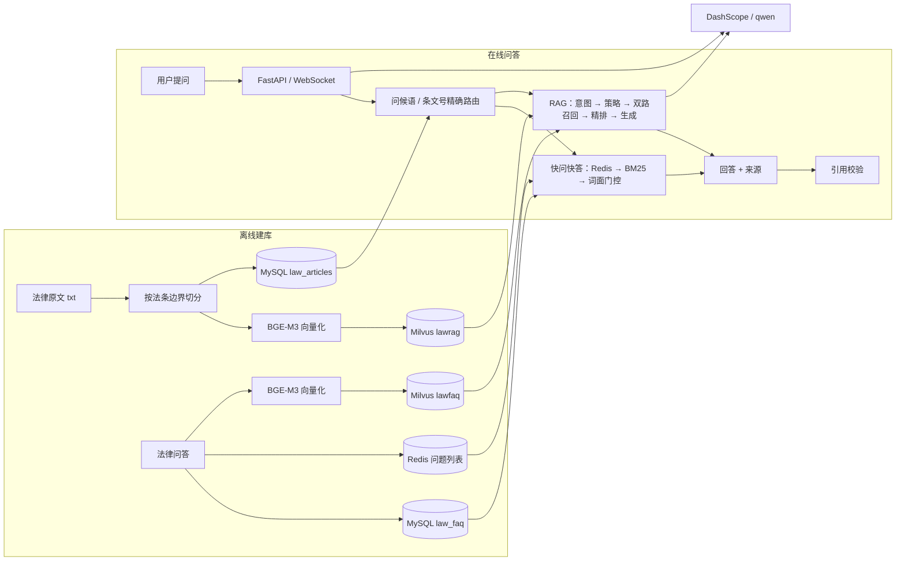
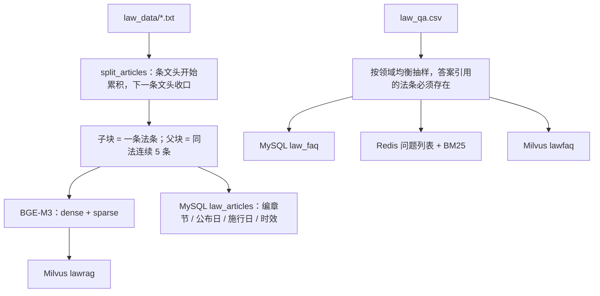
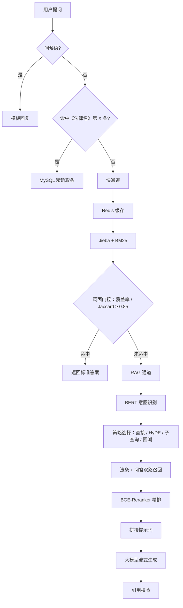
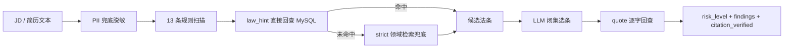

# lawrag 项目介绍

## 1. 项目概览

lawrag 是中文法律领域的 RAG 问答系统。能精确命中法条或库内问答的问题走快通道，其余问题走「法条 + 问答双召回 → 精排 → 大模型生成」的 RAG 通道。回答要求标注《法律名》第 X 条，生成后再做一次引用校验。

系统适合「试用期最长多久」「租房押金不退可以引哪条」这类法条依据问题，不提供个案结论，也不能替代律师。

## 2. 解决什么问题

法律问答和普通文档问答不一样，难点主要有四处：

- 法条不能按固定长度切，切断了就查不到完整条文；
- 用户经常直接问「第 X 条」，这类问题应该走精确路由，不需要向量检索；
- 库内原句和真实用户问题的表述差异很大，快通道容易抢答错误；
- 模型生成的条文号可能是编的，必须回查原文。

lawrag 把「精确命中」「词面快问快答」「语义检索」分开处理，最后统一做引用校验。

## 3. 总体架构

## 4. 离线建库

关键修复：早期切分只保留「第 X 条」开头行，把枚举项和续行丢了，导致 50.2% 的法条正文不完整。修复后改成续行累积，正文覆盖率从 53.54% 提升到 100%，法条总数保持 21,565 条不变。

## 5. 在线问答

快通道用词面判据，不用向量分数。库内原句可以秒回，真实法律问题进入 RAG，避免「看起来相似但结论不同」的问题被直接抢答。

## 6. 核心设计

### 6.1 法条级切分

子块是完整的一条法条，父块是同一部法律连续 5 条，父子关系放在 metadata 里。检索命中一条法条时，送给模型的上下文仍然完整；引用校验也能直接按「法律名 + 条号」回查。

### 6.2 快通道词面门控

用查询词覆盖率、Jaccard 和库内原句做判据，只有词面足够接近才直接返回。调参后错误抢答从 54 条降到 0，真实法律问题进入 RAG 的比例从 10% 提升到 99%。

### 6.3 时效过滤

检索常开 `status == "有效"`。语料里保留 4 部历史版本做新旧对照，但在线问答只应该命中现行有效条文，避免答出已修订或已废止的内容。

### 6.4 领域视图

`domain_profiles.json` 定义领域到法名列表的映射。检索时用现有的 `law_name` 标量字段拼 `in` 过滤，不新增 Milvus 字段，也不重建索引。

| 模式 | 行为 | 用途 |
|---|---|---|
| off | 不过滤 | 全量问答，默认 |
| soft | 先按领域过滤，父块不足 2 条时放开重试 | HR 问答 |
| strict | 只过滤，不兜底 | 合规取证 |

### 6.5 证据型工具接口

`/api/search_law`、`/api/get_article`、`/api/corpus_info` 和 `/api/check_hr_compliance` 都只返回结构化证据，不生成长文本。MCP 薄封装只调这些 HTTP 接口，不 import `app.py`，也不重复加载模型。

## 7. HR 合规检查

约束：

- 规则只负责定位片段、类别和建议，不产生条号；
- 条号只来自 `law_hint` 的 MySQL 回查，或者严格劳动法领域的检索兜底；
- LLM 只能从候选集里选条，不能改 span、category、severity；
- `quote` 必须是 MySQL `article_text` 的连续子串，不通过就丢弃 basis，并标 `needs_human=true`；
- 有风险项但没有任何可回查 basis 时，`citation_verified=false`。

## 8. 数据规模

| 数据 | 规模 |
|---|---:|
| 法律原文 | 292 个文件（288 部现行 + 4 个历史版本） |
| 法条 | 21,565 条（现行有效 21,312，历史版本 253） |
| 法条向量 | 21,565 条 |
| 法律问答 | 20,000 条 |
| 问答向量 | 20,000 条 |
| HR 合规评测 | 140 条 JD（80 违规 / 40 干净 / 20 边界） |

## 9. 实测结果

| 评测 | 指标 | 实测 | 参考标准 |
|---|---|---:|---:|
| 语料 | 正文覆盖率 | 100% | ≥99% |
| 全量检索 | Recall@5 | 0.901 | 修复前 0.824 |
| 全量检索 | MRR | 0.7919 | 修复前 0.7188 |
| HR 检索 | soft Recall@5 | 0.9275 | ≥0.90 |
| HR 检索 | core Recall@5 | 0.9750 | ≥0.90 |
| 生成 | RAGAS 忠实度 | 0.8992 | — |
| 生成 | context_precision | 0.7128 | — |
| 生成 | context_recall | 0.7299 | — |
| HR 生成 | 忠实度 / context_recall | 0.9277 / 0.9443 | — |
| 快通道 | 错误抢答 | 54 → 0 | 0 |
| 快通道 | 真实问题进入 RAG | 10% → 99% | — |
| HR 合规 | P / R / F1 | 1.0 / 1.0 / 1.0 | ≥0.85 / 0.80 / 0.82 |
| HR 合规 | 引用准确率 | 100% | ≥95% |
| HR 合规 | 干净 JD 误报 | 0% | ≤10% |

口径说明：

- 语料修复前的全量 Recall@5 是 0.824，修复后是 0.901，提升来自正文补全，不是调参；
- 140 条 HR 合规评测由 30 条已有样本和 110 条按规则模板生成并逐条核对组成，不是全部人工标注；
- RAGAS 和 HR 生成集是同分布评测，不能据此说「HR 比全量强」；
- 法条引用校验是「条号存在性 + quote 逐字回查」，不是 NLI 级别的语义蕴含判断。

## 10. 技术栈

| 层面 | 选型 |
|---|---|
| 语言 | Python 3.10 |
| API | FastAPI、Uvicorn、WebSocket / SSE |
| 业务库 | MySQL 8 |
| 缓存 / 快通道 | Redis、Jieba、BM25 |
| 向量库 | Milvus（dense + sparse） |
| 向量 / 精排 | BGE-M3、BGE-Reranker-large |
| 意图识别 | BERT 微调分类器 |
| 生成 | DashScope qwen |
| 评测 | Recall@k、MRR、RAGAS、上下文覆盖率 |
| 集成 | MCP 薄封装、HTTP 工具接口 |

## 11. 边界

- 只覆盖法律级文本，不含行政法规、司法解释、地方规定；
- 不提供个案结论，不替代律师；
- 多轮历史按最近 5 轮拼接，跨话题追问可能带偏检索；
- 引用校验暂不识别「第 X 条之一」，只会漏检，不会误报；
- 混合检索里 BGE-M3 稀疏分支对 top-k 排序影响较小；
- HR 合规的 13 条规则是召回上限，规则之外的表述可能漏检，命中项仍需人工复核。

## 12. 与上层 Agent 的关系

lawrag 作为独立的法规知识层，通过 HTTP 和 MCP 给上层 Agent 提供检索、取条和合规检查。两个仓库不共享代码、数据库和索引；上层如何编排流程、如何做人工复核，不在本项目的职责范围内。
